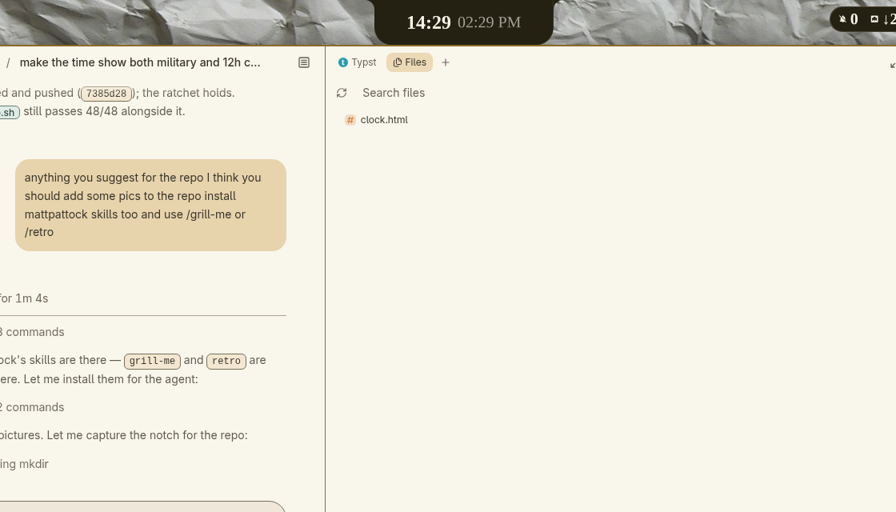
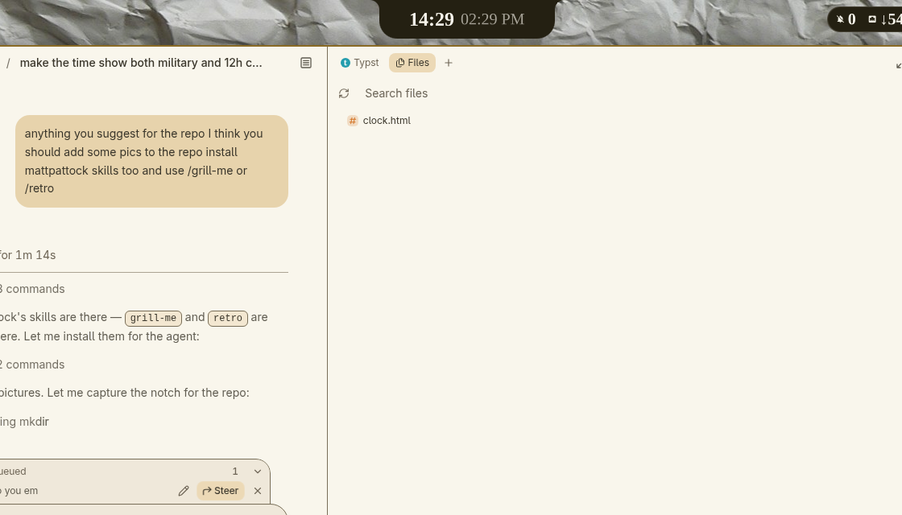
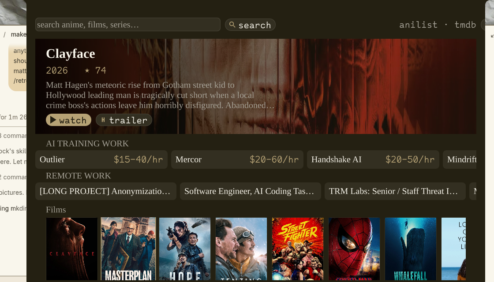

# notch: a lean, niri-native shell

A cut-down, **niri-native** fork of [andreumassanet/impasto](https://github.com/andreumassanet/impasto).
It started as a Quickshell shell for Hyprland and is now a small one for niri,
built for a cloud VM that you reach over RustDesk from an iPad.



The island drops out of the notch: the launcher, the control centre, and a
catalogue that plays in the terminal itself.

| the launcher | the control centre | the catalogue |
|---|---|---|
|  |  |  |

## The device

The notch is the device layer: the media, the panels, the bar, and the IPC
an agent drives. There is no assistant in it. The thinking happens next door
(T3 Code, or any opencode agent), and the notch says what it knows:

```
notch context get        the panel, the hero, the postings, the profile
notch context hand       that, on the clipboard, with T3 in front
notch work hand job 0    one posting, handed over
```

The whole surface is in [docs/ipc.md](docs/ipc.md): every target, every
verb, what it answers with. The decisions behind the shape, and what
settled them, are in [docs/decisions.md](docs/decisions.md).

## The packages

The repository is one repo with a few packages in it, the way pi keeps its
agents in one tree: each thing the shell is made of lives in its own
folder, says what it is, and says where its files land.

| Package | What it is | Lands in |
|---|---|---|
| `packages/shell` | the quickshell app: bar, island, panels, theme | `~/.config/quickshell` |
| `packages/media` | the catalogue and the watching | `~/.config/quickshell/scripts`, `~/.local/bin` |
| `packages/radar` | Notchstorm, the weather radar | `~/.local/bin` |
| `packages/layouts` | the per-desktop window plans | `~/.local/bin` |
| `packages/theme` | the four ink themes | `~/.local/bin` |
| `packages/tools` | the command line | `~/.local/bin` |
| `packages/desktop` | niri, mpv, the fonts, the units | `~/.config`, `~/.local/share` |
| `packages/data` | the themes, the plans, the vendored mov-cli | `~/.local/share/notch` |

Each package has an `install` file: one line per thing, where it comes
from and where it goes. `./setup files` follows them, and
`tests/mirror.sh` checks that the machine still has what the repository
says it has.

## What is kept

| Part | Where |
|---|---|
| Bar: launcher button, niri workspaces, tray, T3 chip, notifications, network, volume, control centre | `bar/` |
| The island: launcher (apps, `=` calculator, `>` desk and themes, windows, clipboard, emoji) | `bar/island/LauncherPanel.qml`, `services/LauncherService.qml` |
| **Catalogue**: anime from AniList, films and series from TMDB, and the watching. The picture plays in the island terminal, not in a window | `bar/island/AnimePanel.qml`, `services/AnimeService.qml`, `scripts/stream.py`, `notch-watch`, `notch-resolve.mjs` |
| **Handoff**: the notch has no brain of its own. It says what it knows (the panel, the posting, the profile to read) and hands it to the agent in front of it | `Commands.qml` (`context`, `work`), `services/T3Service.qml` |
| **Notchstorm**: the radar, live sweep and all | `bar/island/NotchstormPanel.qml`, `services/NotchstormService.qml`, `notchstorm` |
| **Layouts**: per-desktop plans for the windows | `controls/LayoutsBlock.qml`, `notch-layout` |
| Notifications (the shell is the server) and the OSD | `NotificationLayer`, `OsdLayer`, `NotificationService` |
| Control centre: toggles, volume, clock, session, shortcuts, notification list | `bar/island/ControlsPanel.qml`, `controls/` |
| Capture: region, window and screen, annotate (satty), OCR (tesseract), recording (wf-recorder) | `capture/`, `CaptureService`, `RecorderService` |
| Clipboard history | `ClipboardService`, `scripts/clipboard.py` |
| Session menu (log out, restart, shut down) and polkit prompt | `SessionPanel`, `AuthPanel` |
| **T3 Code card**: t3code-web state, the installed nightly against the latest release, Open / Start / Update | `T3Module`, `T3Service`, `scripts/t3.py` |
| **Ink themes**: e-ink, e-ink-dark, red-ink, red-ink-dark | `packages/data/notch/themes`, `notch-theme` |
| niri config with Alt as the main key | `packages/desktop/niri/config.kdl` |

### The picture in the terminal

A title plays where the text is: mpv's truecolour output draws the frame as
characters, so there is no window, no GPU and no compositor rule to fight.
Anime is resolved through hianime; a film or a series through the api the
player itself asks, opened the way the player opens it (a small webassembly
module the api names). The catalogue's watch button starts either.

```sh
notch-watch anime "cowboy bebop" --episode 2
notch-watch film movie 550 "Fight Club" 1999
notch-watch film tv 1396 "Breaking Bad" 2008 --season 1 --episode 3
```

Everything else was cut: Hyprland, the desktop widgets, dock, deck, settings window, lock, games, pets,
weather, markets, GitHub, Claude/Codex meters, VMs, servers, camera effects, the palette engine,
SDDM/Plymouth/GRUB/mkinitcpio, and the dotfiles for kitty, nvim, yazi, zsh and the rest.

## niri

`NiriService` keeps one `niri msg --json event-stream` open (workspaces, windows, focus, overview)
and sends `niri msg action …`. It uses no hyprctl and no shim. The key sheet reads binds from the
niri config (`scripts/niri_binds.py`).

## Install

```sh
./setup            # packages, files (backs up what it replaces), theme e-ink
niri msg action spawn -- qs -n     # or log in again; the niri config spawns it
```

`./setup` only touches `$HOME` and packages. It never changes the boot loader, the initramfs or /etc.

## Commands

```
notch open|toggle launcher|controls|t3|keys|session|clipboard|emoji|anime|notchstorm
notch capture [region|window|screen] | capture text | record
notch context get|hand             what the notch knows, or hand it over
notch work [get|platforms|hand n]  the work: postings and platforms
notch t3 [get|refresh|update|open]
notch volume <n> | volume mute     notch focus toggle
notch-theme set e-ink|e-ink-dark|red-ink|red-ink-dark · next · next-wallpaper
```

`notch-theme` writes the colours for the shell (`~/.local/state/notch/theme.json`), ghostty,
helix, niri's focus ring and border, mako and fuzzel, and runs swaybg as the `notch-wallpaper` user unit.

## Keys (Alt is the main key; Super still works)

| Key | Does |
|---|---|
| Alt+Space | Launcher |
| Alt+Return / Alt+Shift+Return | Ghostty / Helium |
| Alt+Q, Alt+F, Alt+Shift+F | Close, maximise, fullscreen |
| Alt+arrows, Alt+Shift+arrows | Focus, move |
| Alt+1…5, Alt+Shift+1…5 | Workspace, move to workspace |
| Alt+Tab | Overview |
| Alt+Shift+C / T / K / V / . / E | Control centre / T3 / keys / clipboard / emoji / session |
| Alt+Shift+S / A / R | Capture region / capture surface / record |
| Alt+Shift+N | Do not disturb |
| Alt+Shift+Y / W | Next theme / next wallpaper |

GPL-3.0, like upstream.
- [INSTALL.md](INSTALL.md): fresh Arch setup.
